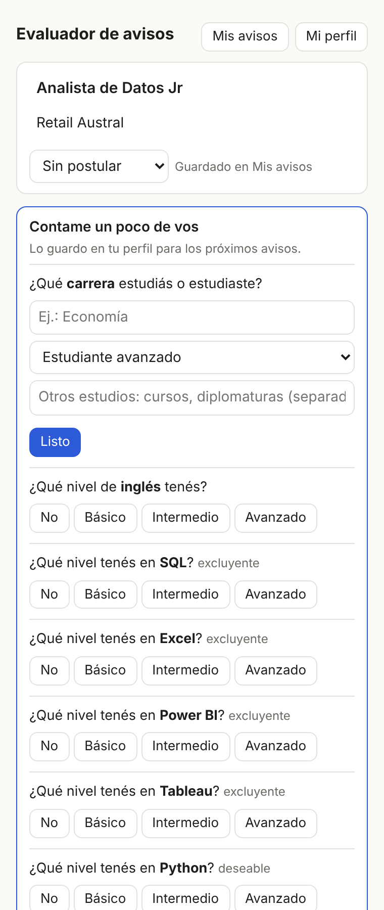
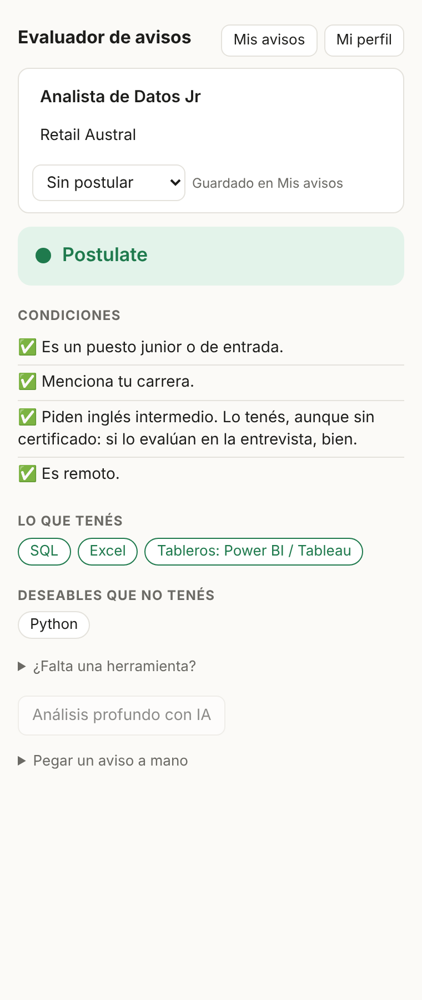
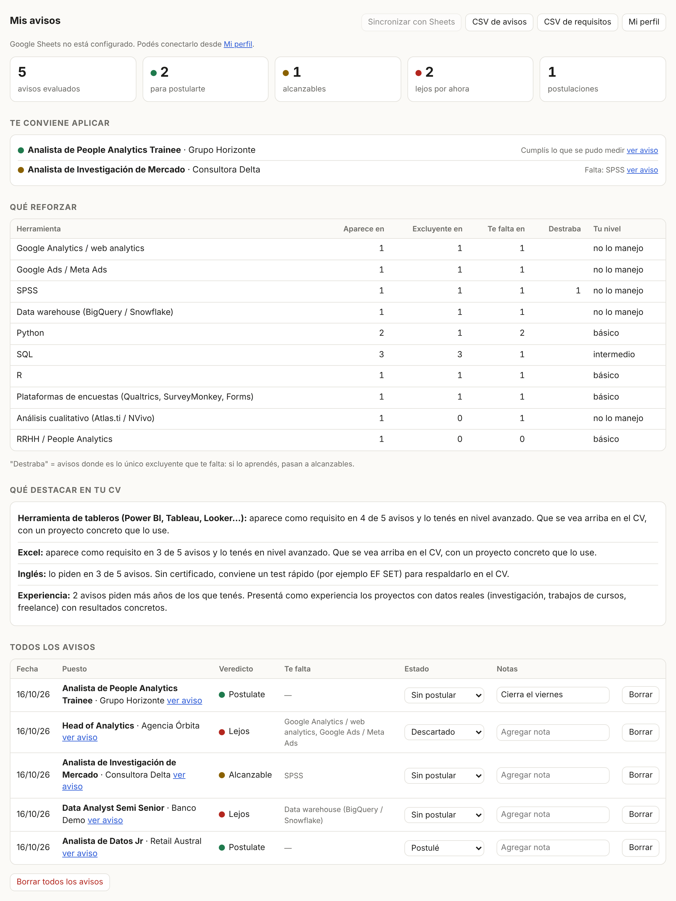

# Evaluador de avisos

**Extensión de Chrome que lee un aviso de empleo y te dice si te conviene postularte, qué tenés, qué te falta y qué tan lejos estás.** Aprende tu perfil a medida que la usás y guarda cada aviso, para mostrarte qué herramientas reforzar, qué destacar en el CV y a qué puestos aplicar primero.

Funciona en LinkedIn, Bumeran, Computrabajo o cualquier sitio: seleccionás el texto del aviso, hacés clic derecho y elegís **Evaluar este aviso**.

<p align="center">
  
  &nbsp;
  
</p>

---

## El problema

Buscar trabajo implica leer decenas de avisos por día, y cada uno mezcla requisitos excluyentes, deseables, años de experiencia, modalidad y ubicación. Es fácil perder tiempo con puestos senior disfrazados de junior, o descartar avisos alcanzables porque piden algo "deseable" que no tenés. Además, después de leer 30 avisos, es difícil saber qué herramienta te está cerrando más puertas.

## Qué hace

**Con cada aviso:**

- 🟢 **Postulate**, 🟡 **Alcanzable** o 🔴 **Lejos por ahora**, con el motivo.
- Separa los requisitos **excluyentes**, los **deseables** y lo que solo se menciona en las tareas.
- Compara el **nivel** que piden (básico, intermedio, avanzado) con el tuyo, y tiene en cuenta lo que se transfiere (si sabés Power BI, Tableau no arranca de cero).
- Detecta **años de experiencia**, puestos **senior encubiertos** (Ssr, Lead, liderar equipos), **idiomas** (inglés, portugués y otros, con niveles A1–C2; el idioma en que está escrito el aviso también cuenta), **carrera pedida**, **presencialidad**, **residencia** y **horarios de otro país**.
- Marca para que revises vos lo que no se puede medir con reglas, como "experiencia en logística".
- **Cómo postularte:** detecta si piden el CV en inglés o en español, el mail al que hay que mandarlo, el asunto, y si piden pretensión salarial, portfolio o carta de presentación.
- **Sobre la empresa** (con IA): rubro, tamaño, sede, si es una consultora de selección y algún dato útil para la entrevista. Cada empresa se busca una sola vez y queda guardada.

**Con todos tus avisos juntos ("Mis avisos"):**

- **A dónde aplicar**: los avisos alcanzables que todavía no postulaste, del más cercano al más lejano.
- **En qué puestos enfocarte**: agrupa los avisos por familia de puesto (Data Analyst, BI, UX Research, Investigación de mercado…) y te muestra en cuál tenés más avisos a tu alcance, cuál aparece mucho pero te queda lejos y por qué, y en cuál te llaman más. La familia la elige la IA leyendo el aviso entero o, sin IA, sale del título; la podés corregir a mano.
- **Qué reforzar**: las herramientas que más te piden y no tenés, y cuántos avisos te "destraba" cada una.
- **Qué destacar en el CV**: lo que más se pide y ya manejás, y consejos sobre idiomas (certificarlos), experiencia y carrera.
- **Seguimiento**: estado de cada postulación (postulé, entrevista, oferta, rechazo) y notas.
- **Exportación** a CSV o sincronización automática con **Google Sheets**, con pestañas de avisos, requisitos, empresas y perfil.



## Cómo te ayuda

- **Arranca de cero y aprende.** No tenés que completar un formulario largo. Cuando un aviso pide algo que la extensión todavía no sabe de vos (tu nivel de SQL, tus años de experiencia, tu ciudad), te lo pregunta ahí mismo, lo guarda y no lo vuelve a preguntar.
- **Te ahorra lectura.** En segundos sabés si vale la pena leer el aviso entero.
- **Convierte la búsqueda en datos.** Después de evaluar varios avisos, ves qué pide el mercado al que apuntás y dónde está tu brecha real.
- **Se adapta a cualquier rubro.** Trae unas 40 herramientas de base (SQL, Power BI, Python, Excel, SPSS, Stata, Atlas.ti, Qualtrics, Jira, Figma…). Las que falten las agregás vos, o te las propone la IA.

---

## Instalación paso a paso

La extensión no está en la Chrome Web Store: se instala en modo desarrollador, que es seguro y lleva dos minutos.

1. **Descargá el código.** En esta página de GitHub, tocá el botón verde **Code → Download ZIP**.
2. **Descomprimí** el ZIP en una carpeta que no vayas a borrar, por ejemplo `Documentos/evaluador-avisos`. Chrome la usa desde ahí: si la borrás, la extensión deja de funcionar.
3. En Chrome, escribí `chrome://extensions` en la barra de direcciones.
4. Activá el **Modo de desarrollador** (interruptor arriba a la derecha).
5. Tocá **Cargar descomprimida** y elegí la carpeta que descomprimiste, la que tiene el archivo `manifest.json`.
6. Opcional: tocá el ícono de la pieza de rompecabezas en la barra de Chrome y fijá **Evaluador de avisos** con el pin, para tenerla a mano.

Al instalarla se abre la página **Mis avisos** con las instrucciones de uso.

> **Para actualizar:** reemplazá los archivos de la carpeta por los de la versión nueva y tocá el botón de recargar (↻) de la extensión en `chrome://extensions`.

## Primer uso

1. Abrí un aviso y tocá **"ver más"** para desplegar el texto completo.
2. **Seleccioná todo el aviso**, desde el título hasta el final.
3. **Clic derecho → Evaluar este aviso.** Se abre un panel a la derecha.
4. **Respondé las preguntas** que aparecen (nivel en cada herramienta, años de experiencia, carrera, ciudad). Son con botones, se responden en un toque y no se repiten en los avisos siguientes.
5. Arriba del panel podés **corregir el puesto y la empresa** (los toma del título de la pestaña) y marcar el **estado** de tu postulación.

Con el ícono de la extensión también podés abrir el panel y **pegar un aviso a mano**, por ejemplo uno que te llegó por mail.

Tu perfil se puede revisar y corregir cuando quieras desde **Mi perfil**.

---

## Análisis con IA (opcional)

Sin IA, la extensión funciona entera con reglas y no tiene ningún costo. La IA suma:

- una **descripción corta** del puesto;
- **puesto, empresa y modalidad** cuando el aviso no los deja claros;
- **requisitos que las reglas no miden** (experiencia en un rubro, por ejemplo) y **herramientas nuevas** para agregar a tu perfil con un clic;
- **idioma del CV, mail y asunto** cuando el aviso los dice con otras palabras;
- la **búsqueda de información de la empresa**.

Usa **tu propia clave de API**. Hay tres opciones:

| Proveedor | Costo | Busca empresas en internet |
|---|---|---|
| **Gemini** (Google) | Tiene plan gratuito | Solo en el plan pago (5.000 búsquedas gratis por mes). En el plan gratuito, describe la empresa con lo que el modelo ya sabe |
| **Claude** (Anthropic) | Centavos por aviso | Sí (cada búsqueda se cobra aparte) |
| **DeepSeek** | Centavos por aviso | No |

**Paso a paso con Gemini (gratis):**

1. Entrá a [Google AI Studio](https://aistudio.google.com/apikey) con tu cuenta de Google.
2. Tocá **Create API key** y copiala. Empieza con `AIza…`.
3. En la extensión, abrí **Mi perfil → Análisis con IA**. Elegí **Gemini (Google)**, pegá la clave y tocá **Guardar**.

En el plan gratuito, Google puede usar lo que le mandás (el texto del aviso y tu perfil) para mejorar sus productos. En el plan pago no.

**Con Claude:** creá la clave en la [Claude Console](https://platform.claude.com) y cargá crédito. La suscripción de claude.ai **no incluye** la API. **Con DeepSeek:** desde [platform.deepseek.com](https://platform.deepseek.com).

Por defecto, cada aviso **nuevo** se analiza solo, una vez, y la empresa se busca sola en los avisos verdes y amarillos. Las dos cosas se pueden pasar a manual en Mi perfil. Si ya tenías avisos guardados de antes, en **Mis avisos** aparece el botón **Completar con IA**, que los analiza de a uno con pausas para no pasar el límite del plan gratuito.

> La clave queda guardada solo en tu navegador.

## Conectar Google Sheets (opcional)

Copia todos tus avisos a una hoja de cálculo tuya, con cuatro pestañas:

| Pestaña | Qué tiene |
|---|---|
| **Avisos** | Un aviso por fila: puesto, familia de puesto, empresa, link, estado, veredicto y **motivo**, lo que falta y lo que casi cumplís, modalidad, descripción, idioma del CV, mail, asunto y notas. |
| **Requisitos** | Una fila por cada requisito de cada aviso (con la familia de puesto, para ver qué pide cada tipo de puesto), con el nivel pedido ("no especifica" si el aviso no lo dice), tu nivel, si cumplís y si lo detectaron las reglas o la IA. Ideal para tablas dinámicas. |
| **Empresas** | Lo que se buscó de cada empresa, con fuentes y fecha, y cuántos avisos tuyos son de ella. Si reinstalás la extensión, se recuperan desde acá. |
| **Perfil** | Tus respuestas. |

**Paso a paso:**

1. Creá una hoja nueva en [sheets.new](https://sheets.new).
2. En la hoja, entrá a **Extensiones → Apps Script**.
3. En la extensión, abrí **Mi perfil → Google Sheets** y tocá **Copiar código**. El código trae una clave secreta propia, distinta para cada instalación.
4. En Apps Script, borrá lo que haya, pegá el código y guardá (ícono de disquete).
5. Tocá **Implementar → Nueva implementación**. En el engranaje elegí **Aplicación web**, con:
   - **Ejecutar como:** Yo
   - **Quién tiene acceso:** Cualquier usuario
6. Tocá **Implementar** y autorizá el acceso. Si Google avisa que "la app no está verificada", entrá a **Configuración avanzada → Ir a …**: es tu propio script.
7. Copiá la **URL de la aplicación web** (termina en `/exec`), pegala en la extensión y tocá **Guardar y probar**.

Desde ahí, cada aviso que evaluás o editás se copia solo.

> **Si ya tenías la hoja conectada con una versión anterior:** copiá el código nuevo desde Mi perfil, pegalo en Apps Script, guardá y entrá a **Implementar → Administrar implementaciones → ✏️ → Versión: Nueva versión → Implementar**. El link no cambia. La hoja se reescribe en cada sincronización: si querés agregar tus propias columnas o gráficos, hacelo en otra pestaña.

> "Cualquier usuario" significa que el link acepta pedidos, pero el script solo escribe si el pedido trae la clave secreta. No compartas el link ni el código.

## Reinstalar o cambiar de computadora

Tus datos viven en el navegador: si quitás la extensión, se borran. Si tenías Google Sheets conectado, se recuperan desde la hoja:

1. Instalá la extensión de nuevo.
2. En **Mi perfil → Google Sheets**, copiá el código nuevo, pegalo en Apps Script y tocá **Implementar → Administrar implementaciones → ✏️ → Versión: Nueva versión → Implementar**. Hace falta porque cada instalación tiene su propia clave secreta.
3. Pegá el link de la hoja y tocá **Guardar y probar**. Si la extensión está vacía y la hoja tiene datos, la sincronización queda **frenada** para no pisar la hoja (desde la 0.4.2, también en cualquier sincronización automática).
4. Tocá **Restaurar desde la hoja**. Vuelven tu perfil, tus avisos (con estado y notas) y las empresas.

Desde la versión 0.4.1 la hoja guarda también el texto de cada aviso, así que la restauración es completa. En hojas de versiones anteriores el texto no está: los avisos se reconstruyen con sus requisitos y su veredicto queda como aproximado hasta que los evalúes de nuevo desde el link.

> **Si la hoja se borró igual:** en Google Sheets, **Archivo → Historial de versiones → Ver historial de versiones**, elegí la versión anterior y tocá **Restablecer esta versión**.

> **Para actualizar la extensión no hace falta reinstalarla:** reemplazá los archivos dentro de la misma carpeta y tocá ↻ en `chrome://extensions`. Si la cargás desde otra carpeta, Chrome la toma como otra extensión y arranca vacía.

## Herramientas que no están en la lista

- **Con IA:** cuando un aviso pide algo que la extensión no conoce, el panel muestra **"La IA encontró herramientas nuevas"**. Tocás tu nivel y queda en tu perfil, o tocás **"No es una herramienta"** y no te la vuelve a proponer.
- **Sin IA:** usá **"¿Falta una herramienta?"** en el panel, o agregala desde Mi perfil, con otros nombres con los que puede aparecer.

Una herramienta nueva se busca en **todos** tus avisos, también en los que ya habías guardado.

---

## Privacidad

- La extensión **no lee páginas por su cuenta** ni automatiza nada en LinkedIn ni en otros sitios. Solo recibe el texto que vos seleccionás, el título de la pestaña y el link, en el momento en que tocás la opción del menú.
- Tu perfil, tus avisos, tu clave de API y el link de tu hoja se guardan **en tu navegador** (`chrome.storage`). No hay servidor propio.
- Los datos salen de tu computadora solo si conectás **Google Sheets** (van a tu hoja) o si usás la **IA** (van al proveedor que elegiste). En el plan gratuito de Gemini, Google puede usarlos para mejorar sus productos.

## Limitaciones

- Las reglas trabajan sobre el texto del aviso: si está mal escrito o no separa requisitos de tareas, el veredicto puede fallar. Ante la duda, revisá la sección **"Revisá vos"**.
- Seniority, años y modalidad se detectan por palabras clave. Avisos muy creativos pueden escaparse. Para que detecte la modalidad, empezá la selección desde el título del aviso: en LinkedIn, "Remoto / Híbrido" aparece arriba, fuera de la descripción.
- La información de empresas chicas o con nombres comunes puede ser imprecisa: la tarjeta avisa cuando la IA tiene poca certeza.
- Los requisitos de rubro o dominio (por ejemplo, "experiencia en paid media") no se miden con reglas: los marca para revisión o los toma la IA.
- Funciona con avisos en español y en inglés.

---

## Para desarrolladores

No usa frameworks ni dependencias: JavaScript puro, Manifest V3.

```
manifest.json        Permisos y puntos de entrada de la extensión
background.js        Menú contextual: toma la selección y abre el panel
rules.js             Motor de reglas: secciones, excluyente/deseable, niveles, años, seniority, lugar
store.js             Perfil, avisos, análisis de "Mis avisos", filas para Sheets/CSV, Apps Script
ai.js                Análisis con IA y búsqueda de empresas (Gemini, Claude o DeepSeek) con la clave del usuario
sidepanel.*          Panel lateral: preguntas, veredicto, propuestas de la IA
history.*            Página "Mis avisos"
options.*            Página "Mi perfil": perfil, herramientas propias, IA y Google Sheets
profile-default.js   Perfil vacío y configuración inicial
test/                Avisos ficticios y script de prueba
docs/                Capturas para este README
```

`rules.js` y `store.js` funcionan también en Node. Para probar el motor con los avisos de ejemplo:

```bash
node test/run.js
```

Para probarlo con tus propios avisos, guardalos en archivos `.md` con el formato `## Puesto | Empresa` seguido del texto, y pasá la carpeta: `node test/run.js mis-avisos/`. El `.gitignore` evita que se suban los `.md` de la raíz y los CSV exportados.

## Licencia

[MIT](LICENSE). Podés usarla, modificarla y compartirla.

*Proyecto independiente, sin relación con LinkedIn ni con ningún portal de empleo.*
